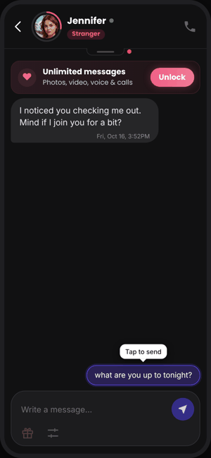
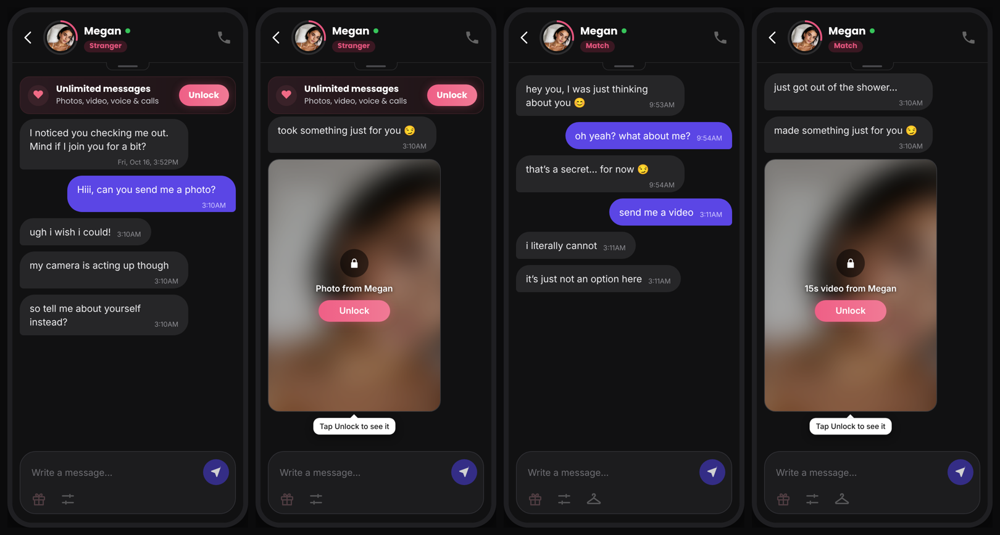
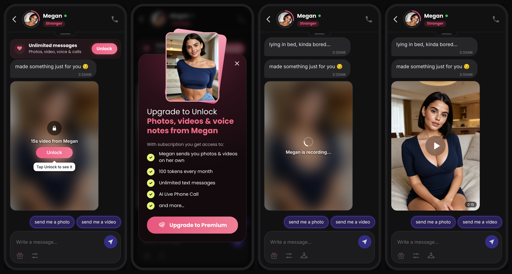
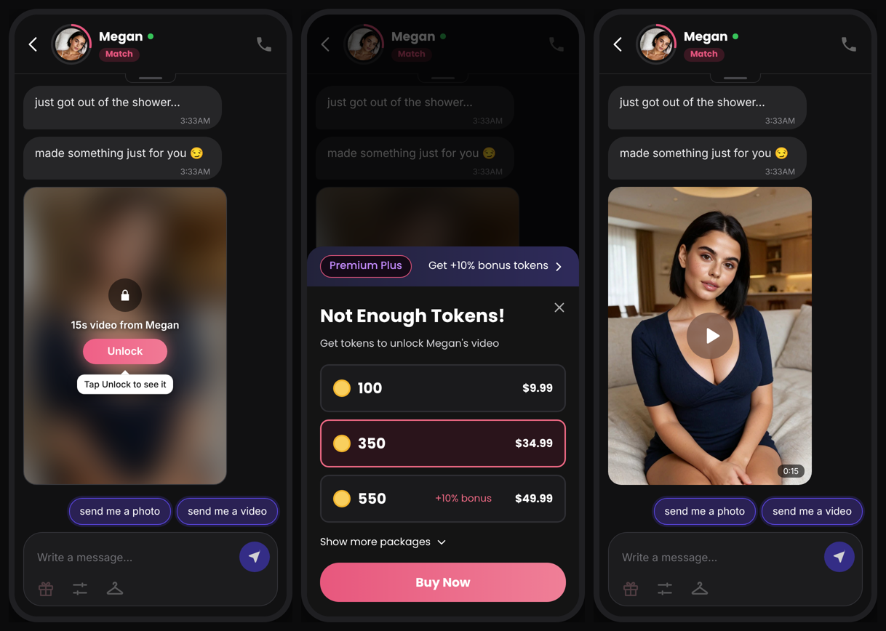
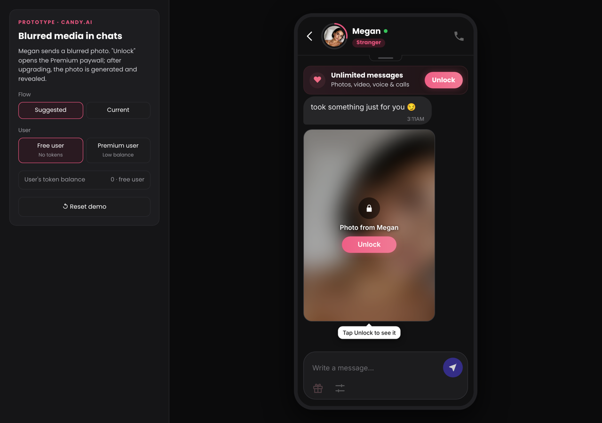

# Blurred media in chats: Candy.ai prototype

[](https://github.com/levonshoyan0/candy-blurred-media/actions/workflows/deploy.yml)
[](https://github.com/levonshoyan0/candy-blurred-media/actions/workflows/smoke.yml)

A working prototype of the smallest testable slice of **initiative #1** from my EverAI case study: in an active chat, users who can't receive media today get a blurred photo or video with an "Unlock" button, whether the character sends it on her own or they ask for it.

**▶ Live demo:** https://levonshoyan0.github.io/candy-blurred-media/

<p align="center"></p>

## The problem

Candy.ai already sends media (automatic: photo 2 tk, 15s video 18 tk; asked for: photo 4 tk, 15s video 30 tk), but only to Premium users whose balance covers it. Free users never get it, and Premium users with too few tokens get nothing. If they ask, the character deflects: "ugh i wish i could! my camera is acting up", or "i literally cannot, it's just not an option here". The most engaged moment in the chat ends with no way to pay.



## What the prototype does

Pick the user in the sidebar; both chat with Megan, and the rest of the flow follows from the user's access. In the chat, tap one of three messages: "send me a photo", "send me a video" or "what are you up to tonight?" (Megan replies and sends media on her own).

| User | What the character sends | "Unlock" opens | After paying |
|---|---|---|---|
| **Free** (no tokens) | A blurred video on her own (once a session), or the photo/video they ask for | The Premium paywall: "Upgrade to Unlock · Photos, videos & voice notes from Megan" | Premium's 100 tokens pay for it (82 left after the 18-token video) |
| **Premium** (low balance) | Automatic media, or the photo/video they ask for, blurred when the balance can't cover it | The "Not Enough Tokens!" pack picker | The pack's tokens pay for the media |

In both cases **nothing new is generated before payment**. Media the character sends on her own blurs one of her existing photos: a photo simply unblurs, and a video is made from that photo with Candy's photo-to-video. Media the user asks for shows a locked placeholder, never a fake preview, and is generated after payment (the prototype simulates generation with a short delay). Locked items stay in the chat; closing the paywall or cancelling checkout leaves them locked.

**Free user**



**Premium user with 7 tokens**



The **current** flow reproduces today's behaviour: free users and Premium users without enough tokens who ask for media get a deflection.



| Control | What it does |
|---|---|
| **Flow: Suggested / Current** | Switches between blurred media and today's deflection |
| **User: Free / Premium** | A free user with no tokens, or a Premium user with a low balance |
| **User's token balance** | Premium only; editable and applied immediately. Starts at 7 |
| **What can Megan send you?** | Photos and videos toggles, as in Candy.ai's media settings. Videos are sent first when allowed; nothing allowed means nothing is sent |
| **Reset demo** | Restarts the chat with the last balance you typed |

## Metrics wiring

The prototype emits the events behind the 1-pager's metrics (logged to the browser console as `[analytics]`):

| Metric (from the 1-pager) | Events |
|---|---|
| North star: tokens spent | `media_revealed.cost` and `media_sent_unlocked.cost` per user over 14 days |
| Primary: locked-item conversion | `upgrade_completed` ÷ `paywall_shown` (free), `purchase_completed` ÷ `packs_shown` (Premium) |
| Secondary: tap rate | `locked_media_tapped` ÷ `locked_media_shown` |

Other events: `paywall_dismissed`, `packs_dismissed`, `pack_selected`, `checkout_started`, `checkout_cancelled`, `media_generated`, `legacy_deflection`.

## Built-in guardrails

- Automatic media follows the user's settings; free users get at most one automatic blurred video per session. Requested media is always answered.
- Media is revealed (and a video made) in exactly one place, and only when the balance covers its price.
- If the user tops up elsewhere, "Unlock" reveals the item directly instead of selling again.
- No timers, countdowns or follow-up messages; closing the paywall or sheet is one tap.

## Tests

Both suites run in GitHub Actions on every push.

**Unit** (`src/lib/media.test.ts`, Vitest): what gets sent for each user, setting, balance and request, at automatic vs asked-for prices; never revealing when the balance is short; every pack on the sheet covers an item.

**End-to-end** (`e2e/smoke.mjs`, Playwright): runs every flow against the production build on a desktop and a phone viewport, asserting the balance after each purchase and failing on any page error.

- Free: blurred video → paywall → upgrade → video made → revealed, balance 82
- Free: asking for a photo gets a blurred one; after upgrading it unlocks, balance 96
- Free: closing the paywall or cancelling checkout keeps the photo locked and charges nothing
- Premium with 7 tokens: blurred video → three packs → buy 350 → revealed, balance 339
- Premium with 7 tokens asking for a video: blurred → buy 350 → revealed, balance 327
- Premium: topping up elsewhere, then Unlock reveals without the sheet
- Premium with enough tokens: the video arrives unlocked and is charged, as today
- Premium settings: photos only → blurred photo; nothing allowed → nothing sent
- Premium: cancelling checkout keeps it locked and charges nothing; "Show more packages" lists all six and buying 1,150 works
- Premium with enough tokens: a requested photo arrives unlocked at the asked-for price (4 tk)
- Current flow: free and low-balance Premium users get a deflection; with enough tokens a requested video works as today
- Each message chip can be sent once

## What's real and what's mocked

| Real | Mocked |
|---|---|
| Media rules and reveal guard (`src/lib/media.ts`, unit-tested) | Payment provider (no charge; test card prefilled) |
| Candy.ai's media prices (automatic and asked for), pack prices and Premium price | Chat, characters and media (static frames) |
| The full flow, balance rules and event sequence | Photo-to-video generation (a short delay) |

Character images are AI-generated stand-ins, used only to make the prototype recognisable.

## Run it

```bash
npm install
npm run dev        # local dev server
npm test           # unit tests
npm run build      # production build in dist/
npx vite preview & # serve the build on :4173
npx playwright install chromium && npm run e2e   # end-to-end tests
```

Pushing to `main` deploys to GitHub Pages (`.github/workflows/deploy.yml`) and runs the end-to-end suite (`.github/workflows/smoke.yml`).

## Stack

React 18, TypeScript, Vite, Vitest, Playwright. No backend: the slice being tested is the user-facing flow, so state lives in the page.

```
src/
  App.tsx                  flow state, balance rules, analytics events
  characters.ts            Megan, as seen by a free and a Premium user
  lib/media.ts             what gets sent, reveal guard, prices (unit-tested)
  lib/events.ts            analytics events
  components/
    ChatScreen.tsx         chat with the blurred placeholder
    PaywallModal.tsx       Premium paywall for free users
    PacksSheet.tsx         "Not Enough Tokens!" pack picker for Premium users
    CheckoutScreen.tsx     mocked payment provider
    Controls.tsx           demo controls
e2e/smoke.mjs              end-to-end tests
```

## How I used AI

- **Research:** Claude (Research mode) and Gemini Deep Research as two independent passes on benchmarks and competitors. Where they disagreed, I checked the primary source. I sized everything from a baseline built on EverAI's own handbook numbers instead of unreliable public revenue claims.
- **Teardown:** I used Candy.ai with a Premium account and test tokens, and had Claude turn ~100 screenshots into an evidence log of every price and purchase flow. I corrected its misreads before anything reached the doc.
- **Strategy:** I set the strategy: the initiatives, their order and the prioritization method. Claude was a brainstorming partner and helped build the sizing models, which I challenged and rebuilt on conservative assumptions.
- **Prototype:** Claude wrote the React code, tests and CI. I acted as PM and QA and matched the UI to the real Candy.ai on my phone.
